# AWS Platform Control Plane

A self-service AWS account and platform control plane.

## Problem

Account vending in enterprise environments is often a slow, manual ticket-based process. Engineering teams wait days for accounts. Security teams struggle with inconsistent baselines. FinOps teams spend hours chasing down who owns un-tagged spend.

## Business Outcome

Provides a declarative, self-service API for requesting AWS accounts. Accounts are provisioned automatically, secured by default with a mandatory baseline, and tagged for FinOps attribution from the first dollar of spend. What took days now takes minutes, with full auditability and idempotency.

## Architecture

```mermaid
flowchart LR
    U[User / CI] -->|CreateAccountRequest| API[API + Schema Validation]
    API --> POL[Policy Engine]
    POL --> DB[(DynamoDB<br/>idempotency + state)]
    DB --> SFN[Step Functions]
    subgraph SFN [Provisioning Workflow]
        direction LR
        CA[CreateAccount] --> BL[ApplyBaseline] --> ID[AssignIdentity] --> BU[CreateBudget] --> MC[MarkCompleted] --> NO[NotifyOwner]
    end
    SFN -.->|retries exhausted| HF[HandleFailure → FAILED / ACTION_REQUIRED]
```



1. **Request:** A user or CI pipeline submits an account request (JSON) to the API.
2. **Validation:** The request is validated against schema and business policies (e.g., minimum budget, approved regions).
3. **Persistence:** The request is stored in DynamoDB using an idempotency key to prevent duplicates.
4. **Orchestration:** Step Functions orchestrates the creation of the account via AWS Organizations, applies the security baseline, assigns IAM Identity Center access, and sets up AWS Budgets.
5. **Completion:** The account is handed over to the requesting team, fully compliant and cost-attributed.

## Design Goals

- **Security:** Secure defaults over optional controls. Every account receives a non-bypassable global baseline (e.g., EBS encryption, S3 Public Access Block).
- **Reliability:** Idempotent operations, exponential backoffs for cross-account IAM propagation, and clear dead-letter handling.
- **Operability:** Structured JSON logging, typed exception hierarchies, and explicit state machines that make it easy to see where a request failed.
- **Financial Accountability:** Budgets and cost-allocation tags are mandatory at request time. No untagged spend.

## Key Decisions

- [ADR 001: Step Functions over ECS](docs/adr/001-step-functions-over-ecs.md) — For orchestrating long-running workflows with built-in retries and wait states (e.g., 7-day decommissioning quarantine).
- [ADR 002: DynamoDB with Optimistic Locking](docs/adr/002-dynamodb-state-store.md) — For serverless, low-latency persistence with guaranteed idempotency and concurrency control.

## Failure Modes

See [Failure Modes Analysis](docs/failure-modes.md) for how the system handles partial provisioning failures, concurrency collisions, and dependency outages.

## Local Demo (no AWS account)

The full lifecycle runs locally via the `control-plane` CLI over a file-backed
store. See [docs/local-demo.md](docs/local-demo.md).

```bash
pip install -e ".[dev]"

control-plane submit --file examples/request.json --idempotency-key demo-key-0001
#  → PENDING_APPROVAL   (passed schema + deterministic policy)
control-plane list
control-plane approve <request_id> --approver alice@example.com
#  → APPROVED
control-plane audit <request_id>
#  REQUEST_SUBMITTED / POLICY_EVALUATED / APPROVAL_GRANTED
```

## Deployment

### Prerequisites
- Python 3.12+
- Terraform 1.5+
- An AWS Organization (for a real deployment; not needed to evaluate)

### Commands
```bash
# Deploy infrastructure (DynamoDB, KMS, SQS DLQ, Step Functions, IAM, alarms).
# Supply real task Lambda ARNs; defaults are clearly-labelled placeholders.
cd infrastructure/terraform
terraform init && terraform apply
```

## Validation

The domain logic, policy engine, approval/audit service, and both persistence
adapters are testable locally with no AWS account. DynamoDB idempotency and
optimistic-locking behaviour are exercised against a `moto`-mocked table.

```bash
pip install -e ".[dev]"
make lint        # ruff check + format check
make typecheck   # mypy --strict
make test        # pytest (43 tests: domain, policy engine, idempotency,
                 #          concurrency, approval/expiry, audit, CLI e2e)
make tf-validate # terraform validate
```

## Security Model

See [Threat Model](docs/threat-model.md) for analysis of spoofing, tampering, and denial-of-service vectors.

## Limitations

This repository is an evaluatable reference implementation, not a deployed service.
Honest scope boundaries:

- **Workflow task Lambdas are not implemented.** The Step Functions ASL validates
  and renders via Terraform, and defines retries/backoff/catch/DLQ, but the task
  Lambdas (CreateAccount, ApplyBaseline, AssignIdentity, CreateBudget, NotifyOwner,
  HandleFailure) are placeholder ARNs. The workflow has not run against a live AWS
  Organization. See [docs/production-boundaries.md](docs/production-boundaries.md).
- **No live-AWS results are claimed.** SLO/latency figures in `docs/slos.md` are
  targets, not measured outcomes.
- **API transport layer is out of scope by decision** ([ADR 004](docs/adr/004-cli-over-api-for-mvp.md)).
  The schemas, domain model, policy engine, and approval/audit service are complete
  and exercised by the CLI; an API Gateway / Lambda entrypoint with OIDC identity
  extraction (threat model §1) is the documented next integration step.
- **Approval is enforced in the service layer** (idempotency, policy gate, approval
  with expiry, audit trail — all tested). The human-approval *wait state* inside the
  provisioning ASL is not yet wired; approval is driven through the service/CLI.

## Roadmap

- Native integration with Backstage / Internal Developer Portals.
- Automated Slack approvals for requests exceeding automated thresholds.
- Pre-warmed account pools for instant vending.
